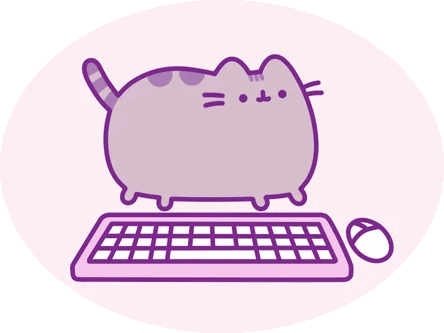

#  Meow Market — интернет-магазин товаров для котов

## Описание

- Проект выполняется в рамках дисциплины «Фронтенд и бэкенд разработка».
- Тема проекта: многостраничный сайт интернет-магазина.
- Название магазина: Meow Market.
- Специализация: товары для котов (корм, игрушки, лежанки, аксессуары, уход).

## Автор

- ФИО: Назарова Виктория Александровна
- Группа: ЭФБО-04-25

## Структура проекта

- `index.html` — главная страница Meow Market;
- `catalog.html` — каталог товаров для котов;
- `css/style.css` — файл стилей;
- `js/main.js` — файл JavaScript;
- `data/popular.json` — данные популярных товаров;
- `data/products.json` — данные товаров каталога;
- `images/` — папка для изображений;
- `README.md` — описание проекта;
- `.gitignore` — список файлов, исключённых из Git.

## Используемые технологии

- Семантический HTML5 (`header`, `nav`, `main`, `section`, `article`, `aside`, `footer`);
- CSS (внешний файл, CSS-переменные, Flexbox, CSS Grid, БЭМ-именование, позиционирование);
- JavaScript;
- Git;
- GitHub.

## Реализованные элементы главной страницы

- фиксированная шапка сайта (`position: fixed`) с логотипом и навигацией;
- бегущая строка с акциями;
- hero-блок с печатающимся заголовком;
- блок «Интересный факт» с подгрузкой случайного факта о котах;
- секция «Наши преимущества» с карточками-флипами (CSS 3D transform);
- секция «Замуррррчательные товары» с динамическим рендером из JSON;
- секция FAQ с раскрывающимися ответами при наведении;
- секция «Как сделать заказ» — слайдер шагов с автопрокруткой;
- секция «Что говорят о нас покупатели» — горизонтальная карусель отзывов;
- выезжающая боковая панель (`<aside>`) с фото кота;
- фиксированная кнопка «Голосование ♥» (`position: fixed`);
- подвал сайта с контактами.

## Реализованные элементы страницы каталога

- сетка карточек товаров на CSS Grid;
- sticky-фильтры (`position: sticky`);
- фильтр по категориям, цене и особенностям;
- сортировка (по популярности, цене, новизне);
- кнопки «Применить» и «Сбросить»;
- динамический рендер товаров из `data/products.json`.

## CSS-архитектура

В проекте используются:

- CSS-переменные в `:root` (цвета, отступы, радиусы, размеры);
- единая шкала отступов и радиусов;
- состояния `:hover`, `:focus-visible`;
- базовое БЭМ-именование классов (`site-header`, `site-nav__link`, `product-card__title`, `advantage-card--from-left` и др.);
- позиционирование: `position: fixed` (шапка, кнопка «Голосование»), `position: absolute` (бейджи на карточках, слайды), `position: relative` (карточки товаров), `position: sticky` (фильтры каталога), `z-index` (шапка, панель).

## Использование Flexbox и Grid

- Flexbox — для шапки сайта, навигации, карточек товаров, hero-блока, блока отзывов, layout каталога;
- CSS Grid — для сетки преимуществ (`grid-template-columns: repeat(2, 1fr)`), сетки популярных товаров (`repeat(3, 1fr)`) и сетки каталога (`repeat(4, 1fr)`).

## Дополнительные элементы

- Open Graph-теги для отображения ссылок в соцсетях;
- фавикон (`images/icon.svg`);
- подключение шрифта Pacifico через Google Fonts;
- кастомный курсор-лапка.

## Самостоятельные доработки (сверх базовой части)

Сверх базовой части контрольной работы №1 добавлены:

- расширенная JavaScript-интерактивность главной страницы
  (карусель отзывов, слайдер шагов, факты о котах, выезжающая панель,
  печатающийся заголовок);
- динамический рендер популярных товаров из `data/popular.json`;
- каталог с расширенной фильтрацией: категории, сортировка, диапазон цен,
  особенности (скидка, новинка, хит);
- sticky-фильтр в каталоге (`position: sticky`);
- динамический рендер товаров каталога из `data/products.json`.

## Текущий статус

Готовы главная страница и каталог Meow Market. Остальные страницы
(карточка товара, форма заявки, контакты) — в разработке.
Ссылка на GitHub Pages будет добавлена после публикации проекта.
